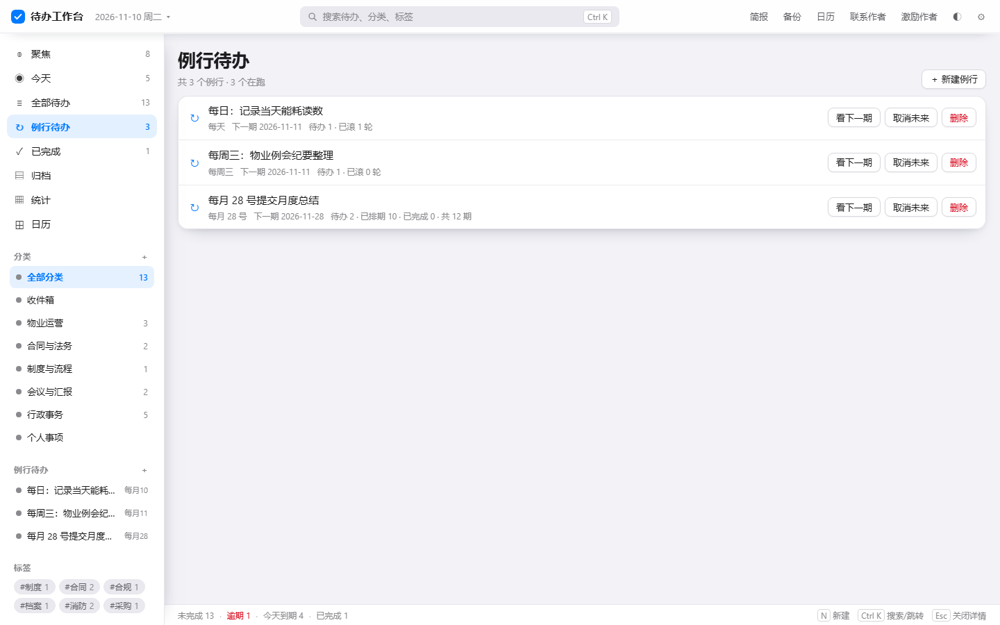
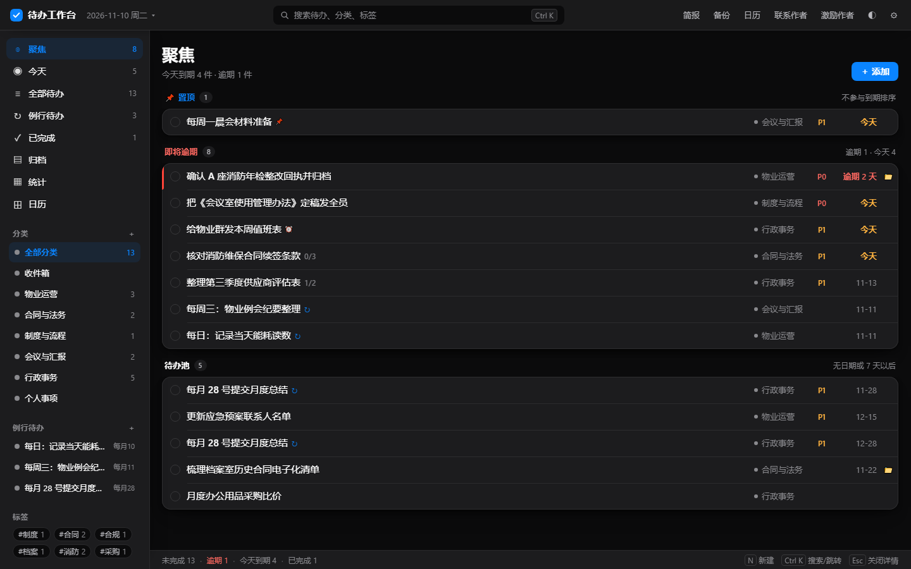
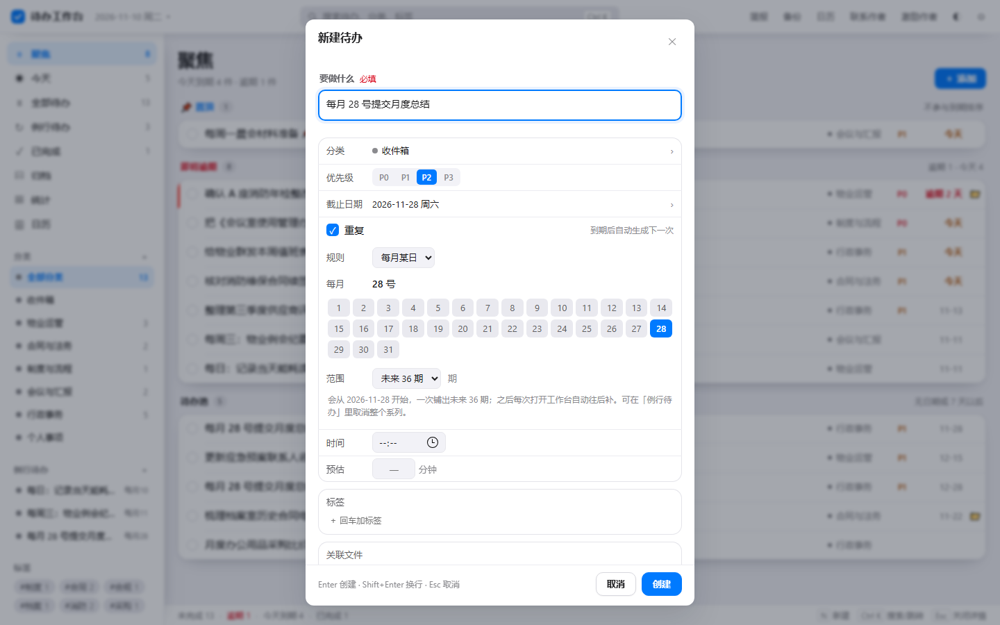
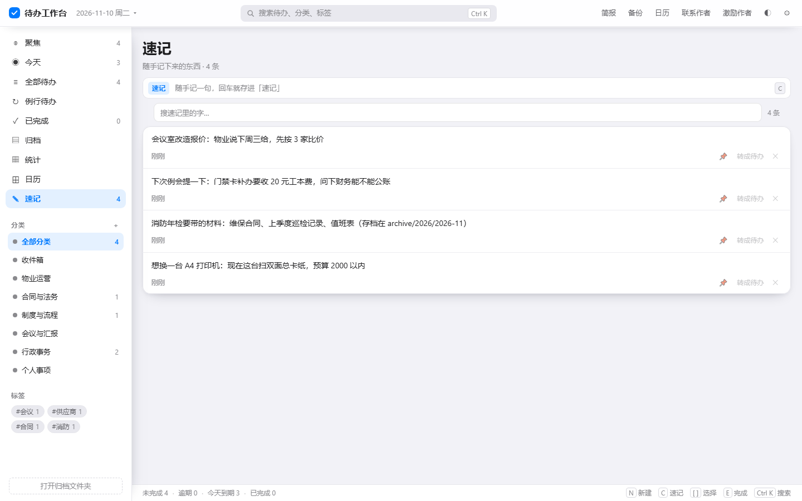
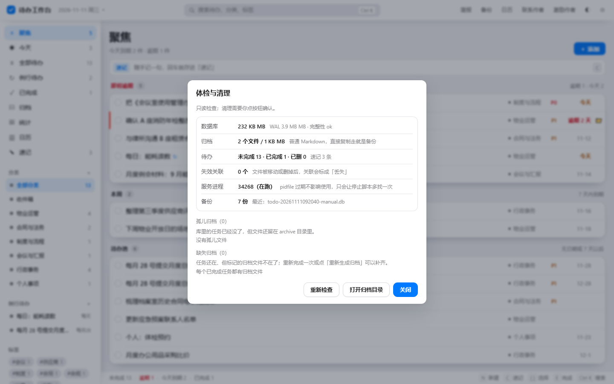
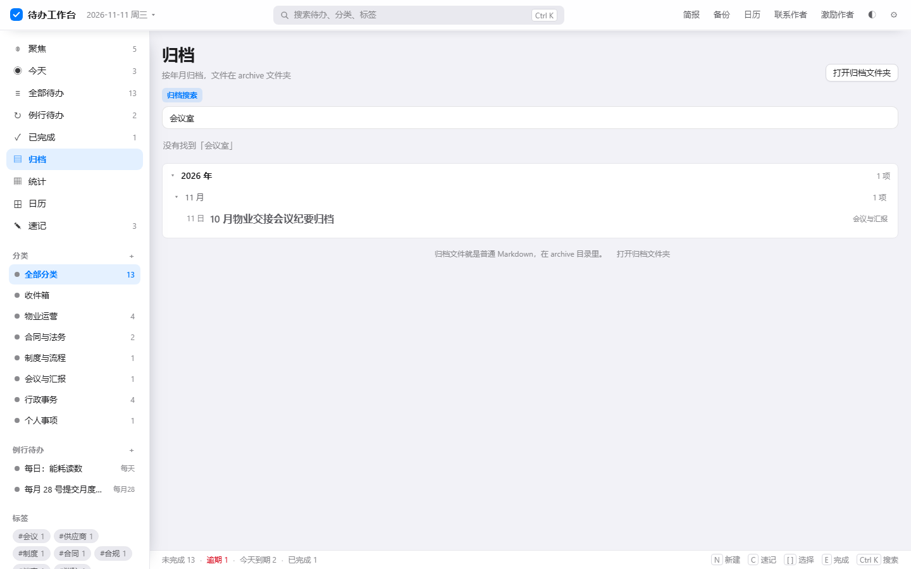

# 待办工作台

一个跑在自己电脑上的待办工作台：本地 SQLite 数据库、按分类和优先级管理、完成后自动归档成 Markdown 目录、把待办和电脑上的文件夹关联起来随时打开。网页界面，双击 `start.cmd` 即可使用，不需要联网、不需要安装数据库。

[](LICENSE)


## 界面预览

| 全部待办（七段时间分段） | 日历（月 / 周，条目可拖拽改期） |
| --- | --- |
|  |  |

| 详情面板（子待办、提醒、关联文件夹） | 例行待办（每月 / 每天 / 每周） |
| --- | --- |
|  |  |

| 深色模式 | 新建例行待办 |
| --- | --- |
|  |  |

| 速记（独立便签库） | 聚焦页小组件 |
| --- | --- |
|  |  |

| 体检与清理（归档对账） | 归档全文搜索 |
| --- | --- |
|  |  |

| 多选批量操作 | 打印今日清单（A4） |
| --- | --- |
|  |  |

<sub>截图用的是演示数据，`npm run seed` 可以自己铺一份；其它页面在 `docs/screenshots/` 里。</sub>

## 快速开始

1. 确认电脑上装了 **Node.js 22.5 或更高版本**（推荐 24）。没装的话去 <https://nodejs.org> 下载 LTS 版，一路下一步即可。
2. 双击 `start.cmd`。命令行窗口会显示几行启动信息，然后**自己关掉**——服务已经转到后台运行，浏览器自动打开 `http://127.0.0.1:7861/`。
3. 之后随便关不关窗口都不影响使用；想彻底退出工作台，运行 `npm stop`（或 `node scripts\stop.mjs`，打包版用托盘菜单里的「退出」）。数据都在磁盘上，下次打开还在。

> 想放桌面：右键 `start.cmd` → 发送到 → 桌面快捷方式。
> 想看实时日志：`data\server.log`；想在前台跑（开发用）：`npm start`，这时窗口关掉服务就停。
> 换端口：命令行里 `set WB_PORT=8080` 再运行 `node scripts\launch.mjs`。

## 界面与用法

**左边**是视图和分类：聚焦 / 今天 / 全部待办 / 例行待办 / 已完成 / 归档 / 统计 / 日历。分类下面带数字的是该分类里还没做的事；右键分类可以改名、换颜色、删除（删除时里面的待办会迁回「收件箱」）。

**中间**是分组内嵌卡片式的列表：每组待办包在一张圆角卡里，行内从左到右固定是：**完成圈 → 标题 → 分类（带色点）→ 优先级（只标 P0/P1）→ 到期（逾期 2 天 / 今天 / 10-24）→ 📁**（置顶的 📌、子项进度 `2/3`、提醒 ⏰ 都跟在标题后面）。左端那条竖线是**紧迫度**：红=已逾期，其余不显示；优先级只看得到 P0 红、P1 橙，避免一行里挤好几种颜色。鼠标移到某行，右侧才会浮出「📌 置顶 / ✎ 编辑 / ✓ 完成 / 🗑 删除」，平时不占地方。点圆圈直接完成，点整行打开右侧详情；没选中任何待办时右栏自动收起，列表更宽。

**选中态**：选中的那一行是「蓝色渐变底 + 1.5px 蓝描边 + 左端蓝条」，卡片首尾行会跟着卡片圆角走，描边不会被切成直角。侧栏、列表、详情三块之间用投影分层，不再靠硬边线。

**配色**对齐 iOS 系统色（浅色底 `#F2F2F7`、卡片白、强调蓝 `#007AFF`、语义红/橙/绿），深色模式换到 iOS 深色（`#1C1C1E` 卡面、`#0A84FF` 强调蓝），两套都只靠 CSS 变量切换。

**顶部月历**（下拉小窗）：点顶栏右侧「日历」，或点左上角日期本身，弹出月历；`PageUp`/`PageDown` 翻月，`Esc` 或点外面关掉。格子下**蓝点=这天有到期待办，绿点=这天完成过待办**，同一天超过 1 件到期会标数字。点任意一天跳到「某一天」的列表，头上有 **到期 / 已完成** 两个开关：

- **到期**：这天要做什么（未来日期默认停在这里）；
- **已完成**：这天做完了什么，标题旁是完成时间，点开详情能看当时的笔记与归档路径（今天与过去默认停在这里）。

格子的计数和列表同一口径：格子上 2 件，点进去就是 2 条。列表头部有「‹ 前一天 / 今天 / 后一天 ›」，键盘 `←`/`→` 也行。

**日历视图**（左侧「日历」）：整月 6×7 或一整周 7 栏两种形态，格子里直接摆当天的待办条目；月视图每格最多 3 条，多的显示「还有 N 条」，周视图整列铺开。把条目**拖到别的格子**就是改期——只改日期，提醒、子项、标签都不动。格子右上角的 `✓3` 是这天完成了 3 件。这个月之外还压着的逾期任务会在页脚提示「另有 N 条逾期未排进来」，点一下去「今天」处理。点格子照旧进「某一天」的列表。

**底部状态条**常驻显示「未完成 / 逾期 / 今天到期 / 已完成」四个数，右边的按键提示也是实时的。

**新建待办**：点右上角「＋ 添加」（或按 `N`、`Ctrl+K` 里搜「新建」），弹出新建窗口：

- **标题**：最上面单独一个输入框，标了「必填」，`Enter` 直接创建，`Shift+Enter` 换行；
- 分类：点开是现有分类列表，点一下就选中；
- 优先级：P0–P3 四个胶囊按钮；
- 截止日期：点开是内嵌月历，可翻月，底部「今天 / 明天 / 清除」；有日期的才填时间；
- 预估耗时（1–1440 分钟）、标签（输入后回车）、笔记（Markdown，会写进归档文件）；
- **关联文件**：可以点「文件夹…」或「文件…」直接挑，也可以粘绝对路径回车；挑文件夹和挑文件走的是系统不同的选择框，中文路径不会乱码；
- **例行待办**：勾上「重复」后选「每月某日 / 每 N 天 / 每 N 周」，每月会立刻铺出未来 N 个月的期；每天、每周只建一条会自己往前滚的活行；
- 「创建」后列表里滚动定位到这条并短暂高亮；`Esc` 取消，什么都不填直接回车会提示「先写一句待办内容」。

## 例行待办（每月 / 每天 / 每周）

勾上「重复」后，一条待办会按选的方式变成周期：**每月某日**会一次铺出未来 12–60 个月，**每 N 天 / 每 N 周**只留一条活行、完成一次滚一次。

- 每月：选号数（1–31，31 号在小月自动收敛到月末），创建即铺满未来 N 个月，**每月到的期当天自动变成待办**；
- 每月还没到的期存在库里但**不进列表、不进逾期计数**（状态 `scheduled`），所以「每月 28 号」不会一下子占满你 36 行；到月份由启动时的排期整理自动放出来；
- 每天 / 每周：只有一条活行，勾掉一次就把这一期写成**已完成的历史行并归档**，活行日期滚到下一期；中间漏掉的期直接跳过，**不会堆出一摞逾期副本**（错过三天再打开，看到的是明天的下一次，不是三条红的）；
- 日历里会把「还没到的那几期」画成虚线小条（不可拖），方便你提前看到这一周/这个月还有几天要做；
- 收起系列用「取消未来」，重新开始用「恢复」；滚动系列被完成的那几期都留在「已完成」和归档里，重新打开其中一期会把它**脱离系列**，不会变成第二条活行；
- 侧栏「例行待办」里能看每个系列：每月系列显示 待办 / 已排期 / 已完成 / 共几期，滚动系列显示 待办 / 已滚几轮，还有「看下一期 / 取消未来 / 恢复 / 删除」；
- 某一期完成后，其它期不受影响；改某一期的标题只影响这一期。

**某一天的列表**里新建时，不写日期就自动落在这一天；「已完成」当天的回顾是只读的，不显示添加入口（免得把「回顾」写成「补记」）。

**右侧详情**里可以改标题、分类、优先级、日期、预估耗时，写笔记（Markdown，会原样写进归档文件），加标签，以及**关联文件夹**：

- 点「浏览…」弹系统选择框，或直接粘贴 `D:\项目\某某资料` 回车；
- 之后列表行上会出现 📁 标记，详情里点「打开」或行内「📁 打开关联」会直接在资源管理器里选中该文件夹；
- 文件夹被移动或删除时，打开会提示，并把它标成「丢失」，仍然保留记录，方便你自己去找。

**快捷键**：`Ctrl+K` 搜索/跳转/执行命令（新建待办、新建例行、新建分类、备份、简报、切换深浅色…），`N` 新建待办，`C` 光标进速记框，`/` 打开搜索，`E` 完成选中的待办，`P` 置顶、`Delete` 删除，`[` / `]` 上下换选中；`Esc` 逐层关闭（速记框 → 详情 → 弹窗 → 搜索）；月历打开时 `PageUp`/`PageDown` 翻月，在某一天的列表里 `←`/`→` 切前一天/后一天。支持深浅色，右上角 ◐ 切换。归档视图顶部可以直接搜归档正文；「今天」里的逾期可以「全推到明天」；每天/每周的例行可以「跳过这一期」；提醒弹出来时能选「稍后 10 分钟 / 1 小时」。`Shift` 或 `Ctrl` 点待办可以连选多条，底部会出现完成 / 改期 / 打标签 / 移分类的批量操作条；「今天」右上角的「打印清单」会把今天要做的排成一页 A4。

**深链**：地址栏可以带参数直接落到某个视图，例如 `/?view=day&date=2026-10-19&mode=done`（`mode` 取 `due` 或 `done`，不写就按「未来看到期、今天与过去看完成」推断），`/?view=stats`、`/?theme=dark` 同理。

## 速记（独立一库）与聚焦页小组件

**速记是一本便签，不是待办**。侧边栏「速记」是它自己的库（存在 `memo` 表里，和任务表完全分开），顶栏搜索不会去搜它，它也不会进聚焦、日历、统计、归档，更不会催你。适合记「会议室改造报价：物业说下周三给」「消防年检要带的材料：…」这类还不想变成任务的东西。

- 顶部那条输入框（左边带「速记」标识）写一句回车就存下来，`C` 键送光标进去，`Esc` 退出；
- 每条速记点正文就地编辑，失焦自动保存，`Esc` 放弃、`Ctrl+Enter` 立即保存；右上角三个动作在悬停时变亮：📌 置顶、转成待办、删除（删除后底部 toast 能撤销）；
- 「转成待办」会把第一行当标题、其余行当备注，直接打开新建窗口，改完日期分类再存；
- 速记视图有独立搜索框，按正文找，`N 条` 计数跟着变；置顶的永远排在最前。

**聚焦页小组件**：聚焦页顶部**常驻**三张卡（时钟 / 迷你月历 / 本周节奏）。没做完的待办到 5 条以上时，它会自动收成**紧凑模式**——字号和行高一起压一档，顶部从约 240px 收到 150px 左右，把高度让给列表，但不会消失：

- **现在**：大号时钟 + 今天日期 + 一句问候（早上好/下午好…），下面算「今天要花多久」——把今天到期任务的预估耗时加起来，比如「预计 2 小时 5 分（3 件里填了预估的）」；最底部是「接下来」那一件（按时间再按优先级挑出来的今天第一条），点一下直接开详情。
- **本月**：迷你月历，有排期的日子下面有圆点，完成过的圆点变绿，今天实心蓝圈；点任意一天跳到那一天。
- **本周**：星期一至星期日七根柱子，柱高是那天有几件事，全部完成的那天变绿；这一周什么都没排时换成一句「这周还没排期，日子是空的也挺好」，而不是七根空柱子。

三条注意：小组件只在聚焦页、且只在待办少于 5 条时出现；它读的是 `/api/calendar`，不会有额外存储；时钟每秒走字，跨零点会自己刷新日期。

**联系作者**：右上角「联系作者」弹出微信二维码（图片在 `public\assets\contact-qr.png`，换成你自己的二维码直接覆盖这个文件即可），扫码反馈问题、提需求都行。

**激励作者**：右上角「联系作者」右边的「激励作者」弹出支付宝收款码（`public\assets\reward-qr.png`，已经从海报里裁出二维码并留了 4.5 个模块的白边，扫码识别率比直接贴整张海报更稳）。完全自愿，不影响任何功能；换码时覆盖同名文件即可。

**界面尺寸**：整套字号在 11–22px 之间、全为整数 px（正文 14、行标题 15、元信息 12–13），行高 40px、分组头 28px；月历翻页按钮统一 28×28 并紧贴月份标题。想验收这些数字可以跑 `node scripts\ui-audit.mjs`，它会把字号、顶栏是否溢出、翻页按钮尺寸与间隙、收款码清晰度逐项量出来。

## 子待办、提醒与置顶

- **子待办**：在详情「子待办」那一栏回车就能加一条，父行标题后显示 `2/3` 这样的进度；勾父任务会把没做完的子项一起完成（子项完成不会反过来改父任务）。子项可以单独改日期、优先级、备注，但**不允许再往下挂孙项**；删父任务会连子项一起进「已删除」，撤销时一起回来。列表、日历、统计、归档都只算一级任务，子项不单独出现在待办列表里，也不会单独生成归档文件——父任务完成时，子项以 `- [x] 标题` 的清单写进同一个 md。
- **提醒**：详情里可以给任务单独设一个提醒时间（和截止时间互不影响）。页面开着时每 20 秒问一次服务端，到点弹右下角提示，并（在「设置 → 开启系统通知」授权后）发系统通知；关掉页面后由桌面启动器每 30 秒轮询一次，用托盘气泡提醒。**同一条提醒只会响一次**：服务端用 `remind_fired` 抢占，谁抢到谁发；迟到超过 15 分钟的只标记不补发（免得开机一口气炸出十条）；改了提醒时间会重新武装。
- **置顶**：行右侧第一颗 📌 或详情里的「置顶」按钮。置顶的任务永远排最前，「聚焦」里单独成一组，不参与到期排序。
- **手动排序**：在「全部待办」里直接把行拖到想要的位置，松手即存（`sort_order`），之后默认排序以你拖过的为准。
- **逾期一键完成**：「今天」视图的逾期组右上角有「一键完成 N 条」，确认框只说你真的会踩到的事（周期任务滚到下一轮、子项一并完成）；中途某条失败不中断，做完告诉你成功几条。
- **导出**：「全部待办」和「某一天」的工具条上有「导出」，导出的是**当前筛选下**的未完成待办（分类、标签、搜索词都算），Markdown 格式，直接贴周报或归档都行。
- **编号列表拆条**：新建窗口里写 `1. 甲 2. 乙 3. 丙` 这样的编号列表，创建时会自动拆成多条待办（少于两个编号就按普通标题建一条，`3.14` 这类小数不会被误拆）。
- **稍后再提醒**：提醒弹出来时可以直接点「稍后 10 分钟 / 1 小时」，服务端把 `remind_at` 往后推并重新武装，到点再响。
- **跳过这一期**：每天 / 每周的例行在列表右侧有「跳过这一期」——这一期不做，系列照常往后滚，不会留下一条「已完成」的假记录。每月例行不支持，直接改那一期的日期即可。

## 归档搜索与体检

- **归档搜索**：归档视图顶部有搜索框，直接在 `archive/` 的 Markdown 里找，不需要额外索引；命中给标题、日期和上下文片段，点一下在资源管理器里定位到那篇文件。月度索引里的标题会跟归档重复，所以有归档命中时不再返回索引。
- **体检与清理**（设置里）：只读地检查数据库大小与完整性、归档文件数与占用、任务/速记条数、失效关联数、服务进程、备份列表；发现**孤儿归档**（库里没任务了、文件还在）或**缺失归档**（任务还在、文件没了）时单独列出来，孤儿可以一键清理（先问你），缺失可以点「重新生成归档」补齐。
- **逾期批量改期**：「今天」视图逾期组右上角的「全推到明天」，一次改一批、只动日期不动完成状态，单条失败不中断，做完汇报成功条数。

## 检查更新

设置里多了「版本与更新」：点**检查更新**会去 `api.github.com` 问最新版本（结果缓存 6 小时，不会每次开机都联网）；有新版本时直接展示这一版的更新说明，点**下载安装包**就地把 34 MB 的安装包下到 `data/updates/`，边下边显示进度，下载完自动比对 GitHub 给的 `sha256`。

每天第一次打开时还会**静默查一次**：失败不打扰你，只有真有新版本时，顶栏右上的齿轮上会多一颗小红点，点开设置就能看到。

下好之后关掉工作台（托盘里退出），双击那个安装包覆盖安装即可——**数据在独立目录，升级只换程序文件，待办和速记不会被覆盖**。

两个细节：

- 整条链路只走 `api.github.com`，不走 `github.com` 网页直链（在很多网络环境里网页那条路会超时，而 API 这条路实测 34 MB 只要三四秒）
- 目前只是「下载好、校验过、提示你去装」，**还不会自动替换程序**；自动重启安装放在下一版

## 多选批量、打印与自动备份

- **多选**：按住 `Shift` 或 `Ctrl` 点待办，可以连选多条（`Shift` 从上次点过的那条开始连选）。选中后底部出现操作条：完成、改到明天、改到本周日、打标签、移分类、取消选择。批量完成会逐条走正常流程（照常写归档），某一两条失败不影响其他条。
- **打印今日清单**：「今天」视图右上角有「打印清单」（命令面板里也能搜到）。打印时不带侧栏和按钮，只出一页 A4：标题按到期日排（逾期在前），每条前面一个方框，方便打印出来打勾；页脚写共几件、预计多久。
- **自动备份**：每天第一次启动时自动 `VACUUM INTO` 一份数据库，只保留最近 7 份「自动」备份（手动点「立即备份」的仍保留 14 份）。设置里的数据位置会显示上次自动备份的时间，备份文件都在 `data/backups/`。

## 数据在哪

```
workbench\
  data\workbench.db      ← 所有待办（SQLite 单文件）
  data\backups\          ← 手动/重置前的数据库备份
  archive\YYYY\YYYY-MM\  ← 完成的待办，一条一个 .md，按年/月存放
    └ _index.md          ← 每个月的索引，可读可搜
```

`archive` 是**普通文件夹**：可以直接用资源管理器打开、搜索、复制、同步网盘，不需要经过这个程序。每条归档文件里写了标题、分类、优先级、创建/完成时间、完成说明和你的笔记。

> 现在库里放了 11 条演示数据（物业、合同、制度、会议、行政、个人各分类，覆盖逾期/今天/本周/无日期等情况），方便你打开就能看到界面长什么样。
> 想从空白开始：先关掉工作台，再运行 `node scripts\reset.mjs`——它会先把当前数据库备份到 `data\backups\`，然后清空待办和归档文件（分类和设置保留）。

备份有三条路：顶栏「备份」按钮、设置里的「立即备份」、或者直接复制 `data\workbench.db`（程序没在跑的时候复制最稳）。数据库用 WAL 模式，正在跑的时候复制，建议连 `-wal` `-shm` 一起复制，或者用按钮备份。

## 打包给同事用

```bat
node scripts\build-dist.mjs
```

产物在 `dist\`（**只出两个包**）：

| 文件 | 大小 | 说明 |
| --- | --- | --- |
| `待办工作台-<版本>-安装包.exe` | ~34 MB | **推荐发给同事**：三步向导，可选「仅为我装 / 所有用户」、可选**安装目录**；数据目录默认在用户目录，装好后按提示改，建开始菜单和桌面快捷方式，能在「设置 → 应用」里卸载 |
| `待办工作台-便携版.zip` | ~34 MB | 解压即用：文件夹里带 `node.exe`、`src\`、`public\`、启动器和 `使用说明.txt`，不写注册表 |

单文件版（`待办工作台.exe`）已经停止发布；便携包里的 `使用说明.txt` 仍是给同事看的两分钟上手指南。

Release 上的两个附件按「发布铁律」用固定名：`todo-workbench-setup.exe`、`todo-workbench-portable.zip`（不带版本号，方便固定链接 `releases/latest/download/…`）。

**安装版的行为约定**（给同事讲清楚这几点就够了）：

- 安装位置：默认 `%LOCALAPPDATA%\Programs\TodoWorkbench`（仅为我）/ `C:\Program Files\TodoWorkbench`（所有用户），向导里可以改。
- 数据位置：默认 `%LOCALAPPDATA%\TodoWorkbench\data`，**不跟程序放一起**，所以卸载重装、升级都不丢待办；安装向导里会写明默认位置与改法（改安装目录下 `config.json` 的 `dataDir`），批量安装也可用 `--data=<目录>` 指定。
- 程序文件装到 `app\<版本>\`，老版本目录不动，升级出问题可以退回上一版；这个版本号由打包时注入，不再写死在源码里。
- 卸载：开始菜单 / 「设置 → 应用」；默认**保留数据**，勾「同时删除数据」才删。
- 安装包与启动器都支持静默参数，方便批量给同事装：
  `待办工作台-<版本>-安装包.exe --elevated --user --no-desktop --dir="D:\Tools\TodoWorkbench" --data="D:\TodoData"`（`--machine` 装给所有用户，`--launch` 装完直接启动）。
- 想核对向导排版：`…-安装包.exe --preview=1|2|3 --shot=<png>` 会把那一页画成图片再退出（开发用，不会真的安装）。

打包用到的原料（都在仓库里，可复现）：

- `build\src\launcher\`：启动器源码（.NET Framework 4.x，Win10/11 自带运行时）。负责
  ① 便携版目录里直接带程序文件；② 探测是否已在运行；③ 后台起 `node.exe src\server.mjs`
  （`CreateNoWindow`，日志写 `<安装目录>\logs\launcher.log` 和 `工作台数据\server.log`）；
  ④ 等健康检查通过再开浏览器（浏览器调用分四级回退，管理员身份运行时跳过 ShellExecute，避免浏览器被提权拦住）。
- `build\src\setup\`：安装程序源码（WinForms 三步向导 + 静默参数 + 卸载器）。
- `build\app.ico`：图标，由 `scripts\make-icon.py` 生成（需要 Pillow）。
- 编译用 `C:\Windows\Microsoft.NET\Framework64\v4.0.30319\csc.exe`，不依赖 Visual Studio。

**数据位置**：便携版的启动器把 `WB_DB` / `WB_ARCHIVE` / `WB_BACKUP` 指到 exe 旁边的 `工作台数据\`，
所以整个文件夹拷走就是完整备份；目录只读时自动退回 `%LOCALAPPDATA%\TodoWorkbench\data`。
安装版则由安装目录下的 `config.json` 指定数据目录（默认 `%LOCALAPPDATA%\TodoWorkbench\data`）。

**关于「签名」**：exe 目前是未签名的（`Get-AuthenticodeSignature` = NotSigned）。
代码签名需要一张真实的代码签名证书（PFX，需向 CA 申请，通常要企业资质和年费），
「陈春天的哥哥」是一个署名，不是证书，没法直接签。署名目前写进了文件属性
（产品/公司/版权），在文件属性里能看到。若以后拿到 PFX：

```bat
signtool sign /fd sha256 /f your-cert.pfx /p 密码 /tr http://timestamp.digicert.com /td sha256 "dist\待办工作台.exe"
```

未签名 exe 第一次运行会弹 SmartScreen「Windows 已保护你的电脑」，
点「更多信息 → 仍要运行」即可；走微信/网盘传的 zip 一般不会拦。

## 命令行小工具

```bat
node scripts\doctor.mjs      :: 自检：Node 版本、SQLite、目录权限、数据库完整性
node scripts\smoke.mjs       :: 接口冒烟测试（会自己起服务、建测试数据并清理）
node scripts\ui-smoke.mjs    :: 界面渲染冒烟（用内置 DOM 跑一遍 app.js，需先启动服务）
node scripts\e2e.mjs         :: 真浏览器端到端：建→改→完成归档→撤销→清理（需先启动服务）
node scripts\ui-audit.mjs    :: 界面尺寸审计：字号是否整数、顶栏是否溢出、月历翻页按钮与间隙、收款码清晰度
node scripts\shots.mjs       :: 用无头 Edge 给各个界面拍照，存到 data\shots\
node scripts\seed-demo.mjs   :: 写入一组演示数据
node scripts\reset.mjs       :: 清空所有待办和归档文件（会先自动备份）
node scripts\audit-js.mjs     :: 开发用：扫 app.js 里引用了但没定义的函数/变量
node scripts\build-dist.mjs   :: 打包：生成 dist\ 下的安装包和便携包
```

`smoke.mjs` 不传 `--url` 时会自己在 7901 起的随机端口拉一个临时服务跑完再关，不碰你在用的实例；
`ui-smoke.mjs`、`e2e.mjs`、`shots.mjs`、`ui-audit.mjs` 默认连 `http://127.0.0.1:7861`，加 `--url http://127.0.0.1:7862` 可指向别的实例。
几个「真浏览器」脚本只用到系统自带的 Microsoft Edge 和 Node 22 自带的 WebSocket，不需要装 puppeteer。

## 当前测试覆盖

| 脚本 | 覆盖 | 最近结果 |
| --- | --- | --- |
| `smoke.mjs` | 206 项：增删改查、分类、优先级、标签、归档文件内容、乐观锁、软删除、备份、日历区间、`doneOn`（某天完成）与非法日期、创建时带文件夹要回 `links`/`linkError`、每月重复（铺期 / 排期 / 号数收敛 / 取消 / 恢复 / 删除）、每天与每周滚动（活行 / 历史行 / 日历虚拟期 / 重启后不堆逾期 / 重新打开脱离系列）、子待办（一层限制 / 不进列表 / 删父连带 / 恢复找回 / 父完成级联 / 归档清单）、提醒（领取只发一次 / 迟到不补发 / 改时间重新武装 / 非法格式 400）、置顶与手动排序（含非法 ids）、导出 Markdown、日历条目、速记（建 / 搜 / 改 / 置顶 / 乐观锁 / 软删恢复 / 彻底删除 / 空与超长 400）、静态素材（收款码 200 + `image/png` + 真 PNG 头、`../` 穿越被挡）、维护体检与孤儿清理、归档全文搜索、逾期批量改期、提醒稍后再说、例行跳过一期、检查更新接口与错误处理、自动备份、批量改属性 / 改期 / 完成 | 206/206 |
| `ui-smoke.mjs` | 133 项：各视图渲染、卡片/行结构、月历 42 格、点日期进当天、到期↔已完成切换、回顾里能开详情、新建窗口（分类抽屉 / 内嵌日历 / 重复三档 / Esc）、重复页、联系作者与激励作者二维码（含连开两个弹窗互不误挡）、新建→完成→归档、子待办与提醒字段、序号拆条、逾期一键、七段分组与置顶、导出按钮、日历视图（42 格 / 条目 chip / 可拖拽 / 周视图 7 列 / 周期虚拟条目不可拖）、速记框与解析、聚焦页小组件常驻与紧凑模式、速记库（侧栏入口 / 搜索 / 空态 / 速记条只存速记不建待办）、多选操作条与打印清单 | 133/133 |
| `e2e.mjs` | 72 项：真浏览器里用新建窗口建一条带分类/日期/优先级/标签/文件夹的待办、校验落库、完成并归档、撤销、某天完成回顾链路、每月重复建系列并打开其中一期、联系作者与激励作者二维码（图片真加载、正方形不拉伸、Esc 关闭）、键盘流（C 进速记框 / Esc 退出 / `/` 开搜索）、设置里的版本与更新、打印清单内容、Shift 多选操作条、页面零异常 | 72/72 |
| `ui-audit.mjs` | 字号全整数且 ≥10px、900px 顶栏不溢出、月历翻页按钮 28×28 且左右间隙对称、弹窗关闭/主按钮点击区、收款码尺寸与弹窗完整可见 | 全部通过 |
| `doctor.mjs` | Node/SQLite/目录/数据库完整性/端口 | 全部通过 |

## 日期口径与「聚焦」怎么算

- 日期都是本地日期，不带时区；每天凌晨自动换算。
- **紧迫度**：逾期 1.0+；今天 1.0；1–3 天内 0.85 递减；4–7 天内 0.55 递减；更远 0.3 递减；无日期 0.15 起，放得越久越涨。
- **分数** = 100 ×（0.55 × 优先级权重 + 0.45 × 紧迫度）。它只在后台决定「智能排序」的先后，不再显示成数字，也不会“自动修改”你的优先级。
- **聚焦**分三块：「即将逾期」（逾期 + 今天 + 3 天内到期 + 沉了很久没动的 P0/P1，永远不隐藏）、「本周」（7 天内到期）、「待办池」（其余，按分数排队但不催你）。
- 提前提醒天数、本周范围、沉睡阈值都可以在「设置」里改。
- 重复系列里还没到月份的期（每月档）（`scheduled`）不计入未完成、不参与逾期与「即将逾期」的分区，到月自动放出来；每天 / 每周档只有一条活行，完成时才写历史行，所以永远不会堆逾期副本。

## 常见问题

**双击 start.cmd 一闪而过？** 说明 Node 没装或版本太低，窗口里会提示；装好 Node 24 再来一次。

**浏览器没自动打开？** 手动在浏览器输入 `http://127.0.0.1:7861/`（端口被占用时会自动换端口，看命令行窗口里打印的地址）。

**双击 exe 没反应 / 只弹了个空白窗口？** 看 `logs\launcher.log` 最后几行：`app-mode via … (default profile)` 是应用窗口方式，`open browser via #n` 是退回了默认浏览器。应用窗口被系统或浏览器拦下时，启动器会自动退回用浏览器打开；也可以点托盘菜单「打开工作台」，或按窗口里的「没反应？点这里」复制地址手动开。注意别把 exe 放在会被云盘/杀软实时扫描的目录（比如百度网盘下载目录），那里容易被锁文件。

**提示 401 或打不开页面？** 请通过 `start.cmd` 启动并通过 `127.0.0.1` 访问。页面里带了一次性令牌，直接双击 `public\index.html` 是不能用的。

**能多人一起用吗？** 不能，这是单机单人的工作台；不要把这个端口暴露到局域网或公网（服务只监听 127.0.0.1，并校验 Host 和令牌）。

**以后想打包成 exe？** 界面和数据库都是纯本地、零依赖的，换一种外壳即可；当前先保证数据结构和归档目录稳定，迁移成本很低。

**数据会不会被程序弄丢？** 每次完成/修改都直接写 SQLite；完成时先改数据库再写 Markdown，写文件失败会记录在任务的 `archive_error` 里并在详情里提示，重跑「重新生成归档」即可补齐。

## 许可证

[MIT](LICENSE) © 2026 Sorenzc。可以自由使用、修改、分发，包括商用；保留版权声明和许可证文本即可。
